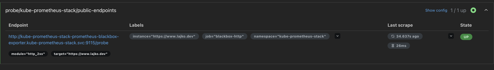
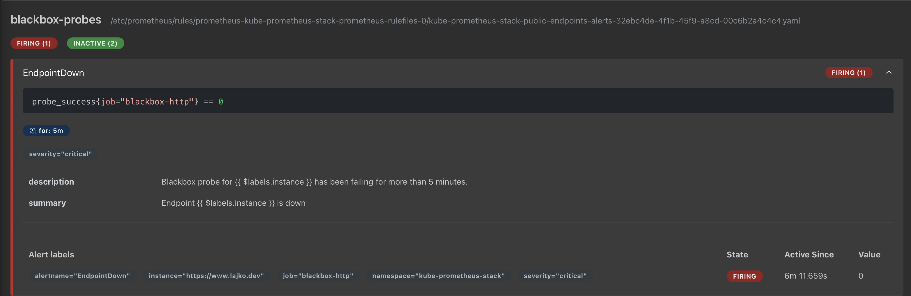
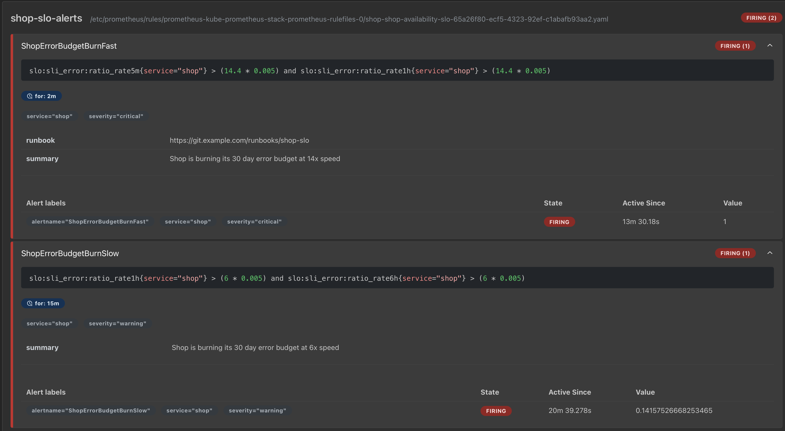
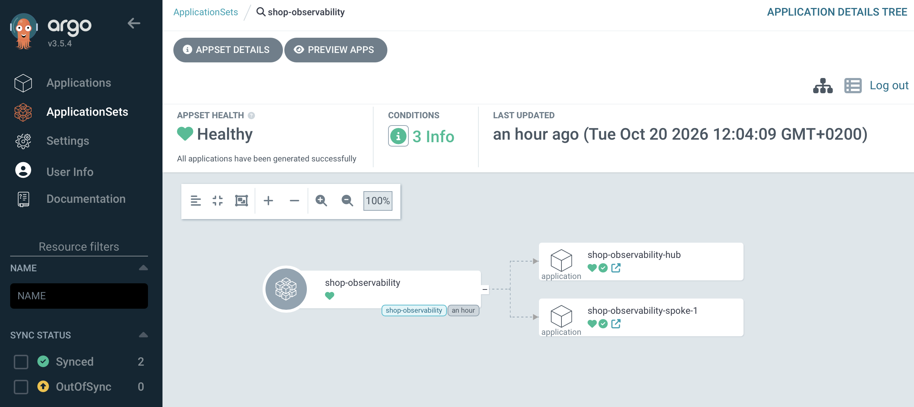

# Chapter 11: Observability with GitOps

Here you will find the examples for the chapter.

We start with a simple example that shows how observability and GitOps work together, and build up from there.

The setup uses the kubara remote setup on a productive Kubernetes cluster, but you can use the local setup you already know. None of the examples depend on kubara. They are plain Kubernetes resources and fit into any GitOps workflow.

The kube-prometheus-stack is part of the default catalog and also deploys the Blackbox Exporter in version <= 0.17.0.

## Example 1: External Observability

We create a Probe and a matching alert rule.

```yaml
apiVersion: monitoring.coreos.com/v1
kind: Probe
metadata:
  name: public-endpoints
  namespace: kube-prometheus-stack
  labels:
    release: kube-prometheus-stack
spec:
  jobName: blackbox-http
  interval: 60s
  module: http_2xx
  prober:
    url: kube-prometheus-stack-prometheus-blackbox-exporter.kube-prometheus-stack.svc:9115
  targets:
    staticConfig:
      static:
        - https://www.lajko.dev
```

```yaml
apiVersion: monitoring.coreos.com/v1
kind: PrometheusRule
metadata:
  name: public-endpoints-alerts
  namespace: kube-prometheus-stack
  labels:
    release: kube-prometheus-stack
    monitoring.instance: hub-dev
spec:
  groups:
    - name: blackbox-probes
      rules:
        - alert: EndpointDown
          expr: probe_success{job="blackbox-http"} == 0
          for: 5m
          labels:
            severity: critical
          annotations:
            summary: "Endpoint {{ $labels.instance }} is down"
            description: "Blackbox probe for {{ $labels.instance }} has been failing for more than 5 minutes."
        - alert: EndpointSlow
          expr: probe_duration_seconds{job="blackbox-http"} > 2
          for: 10m
          labels:
            severity: warning
          annotations:
            summary: "Endpoint {{ $labels.instance }} is slow"
            description: "Probe duration for {{ $labels.instance }} has been above 2s for 10 minutes."
        - alert: EndpointCertExpiringSoon
          expr: probe_ssl_earliest_cert_expiry{job="blackbox-http"} - time() < 14 * 24 * 3600
          for: 1h
          labels:
            severity: warning
          annotations:
            summary: "TLS certificate of {{ $labels.instance }} expires soon"
            description: "The certificate expires in less than 14 days."
```

Commit the manifests and let GitOps deploy them.

What happens?

The Probe produces the measurements, the PrometheusRule evaluates them. The two are connected through the metrics and the label `job="blackbox-http"`.

1. `jobName` becomes the `job` label in the expression.
   `jobName: blackbox-http` from the Probe turns into the label `job="blackbox-http"` on every metric it produces. The rules filter on exactly that with `probe_success{job="blackbox-http"}`. If you rename the job, no rule finds data anymore and the alerts go silent without any error.

2. `targets` become the `instance` label.
   Every target under `static` shows up as `instance="https://www.lajko.dev"` on the metrics. That is why `{{ $labels.instance }}` works in the annotations, and why every additional URL gets its own alerts automatically.

3. `module: http_2xx` defines what `probe_success` means.
   The module is defined in the Blackbox Exporter and decides what counts as success. For `http_2xx` that is an HTTP status code in the 2xx range. The result is `probe_success` 1 or 0, which `EndpointDown` evaluates.

4. The three rules use three metrics from the same Probe:

| Alert | Metric | Condition |
|---|---|---|
| EndpointDown | probe_success | = 0 for 5 minutes |
| EndpointSlow | probe_duration_seconds | > 2 s for 10 minutes |
| EndpointCertExpiringSoon | probe_ssl_earliest_cert_expiry | expires in < 14 days, for 1 hour |





Because you monitor a resource from the outside, we call this external observability. It is not limited to websites. You can probe a Service inside Kubernetes the same way, as if you ran curl against it from outside. This is useful when you want the status of an internal service, such as a webshop, checked through the same Service that the Ingress routes to.

## Example 2: SLOs as PrometheusRule

The second example combines SLOs with GitOps, based on the OpenTelemetry demo shop.

After the first example you know how to extend the observability stack to watch external systems. Watching alone does not help, though. You need a target that says what good looks like, and an alert that fires when you move away from it too fast. That is what an SLO does.

Basic terms:

- SLI (indicator): the share of failed requests, that is 5xx divided by all requests.
- SLO (objective): 99.5 percent success.
- Error budget: 100 percent minus 99.5 percent = 0.5 percent. That is how many failures you can afford in 30 days.
- Burn rate: how fast you spend the budget. Burn rate 1 means the budget lasts exactly 30 days. Burn rate 10 means it is gone after 3 days.

```
           rate of 5xx requests at the Traefik service
SLI = ───────────────────────────────────────────────
           rate of all requests at the Traefik service
```

The PrometheusRule below implements an availability SLO for the shop: 99.5 percent of requests should be answered without a 5xx error, measured over 30 days. It does not alert on single errors. An alert fires only when the error budget is spent too fast. This is the multi-window, multi-burn-rate method from the Google SRE Workbook.

| Recording rule | Window | Purpose |
|---|---|---|
| slo:sli_error:ratio_rate5m | 5 min | reacts fast, but is noisy |
| slo:sli_error:ratio_rate1h | 1 h | middle ground |
| slo:sli_error:ratio_rate6h | 6 h | slow, but stable |

The data comes from Traefik. `service="shop-shop-80@kubernetes"` is Traefik's name for the Kubernetes Service `shop` in namespace `shop` on port 80. The measurement happens at the ingress, which is what the user experiences.

The basic idea: 0.5 percent errors over 30 days are allowed, that is the error budget. The burn rate tells you by which factor you are currently spending faster than allowed. Everything else is simple arithmetic, starting from the 99.5 percent SLO.

Error budget:

- 100 percent minus 99.5 percent = 0.5 percent = 0.005

Thresholds in the alerts:

- Fast: 14.4 x 0.005 = 0.072 = 7.2 percent
- Slow: 6 x 0.005 = 0.03 = 3 percent

Budget gone in:

- At burn rate 1 the budget lasts exactly 30 days, so:
- Fast: 30 days / 14.4 = about 2.1 days
- Slow: 30 days / 6 = 5 days

Your current burn rates (value / 0.005):

- Fast: 1 / 0.005 = 200
- Slow: 0.1416 / 0.005 = about 28

Where 14.4 and 6 come from (Google SRE Workbook): the factors are chosen so that an alert fires once a defined share of the monthly budget has been burned. 30 days have 720 hours.

Enough theory. Now the implementation.

Define the PrometheusRule and deploy it with GitOps.

```yaml
apiVersion: monitoring.coreos.com/v1
kind: PrometheusRule
metadata:
  name: shop-availability-slo
  namespace: shop
  labels:
    release: kube-prometheus-stack
    monitoring.instance: hub-dev
spec:
  groups:
    - name: shop-slo-recording
      interval: 30s
      rules:
        - record: slo:sli_error:ratio_rate5m
          labels:
            service: shop
          expr: |
            sum(rate(traefik_service_requests_total{exported_service="shop-shop-80@kubernetes", code=~"5.."}[5m]))
            /
            sum(rate(traefik_service_requests_total{exported_service="shop-shop-80@kubernetes"}[5m]))
        - record: slo:sli_error:ratio_rate1h
          labels:
            service: shop
          expr: |
            sum(rate(traefik_service_requests_total{exported_service="shop-shop-80@kubernetes", code=~"5.."}[1h]))
            /
            sum(rate(traefik_service_requests_total{exported_service="shop-shop-80@kubernetes"}[1h]))
        - record: slo:sli_error:ratio_rate6h
          labels:
            service: shop
          expr: |
            sum(rate(traefik_service_requests_total{exported_service="shop-shop-80@kubernetes", code=~"5.."}[6h]))
            /
            sum(rate(traefik_service_requests_total{exported_service="shop-shop-80@kubernetes"}[6h]))
        - record: slo:objective:ratio
          labels:
            service: shop
          expr: vector(0.995)
        - record: slo:error_budget:ratio
          labels:
            service: shop
          expr: 1 - 0.995
    - name: shop-slo-alerts
      rules:
        - alert: ShopErrorBudgetBurnFast
          expr: |
            slo:sli_error:ratio_rate5m{service="shop"} > (14.4 * 0.005)
            and
            slo:sli_error:ratio_rate1h{service="shop"} > (14.4 * 0.005)
          for: 2m
          labels:
            severity: critical
            service: shop
          annotations:
            summary: "Shop is burning its 30 day error budget at 14x speed"
            runbook: https://git.example.com/runbooks/shop-slo
        - alert: ShopErrorBudgetBurnSlow
          expr: |
            slo:sli_error:ratio_rate1h{service="shop"} > (6 * 0.005)
            and
            slo:sli_error:ratio_rate6h{service="shop"} > (6 * 0.005)
          for: 15m
          labels:
            severity: warning
            service: shop
          annotations:
            summary: "Shop is burning its 30 day error budget at 6x speed"
```

Next, deploy the shop application. Create Helm values like these:

```yaml
prometheus:
  enabled: false
grafana:
  enabled: false
jaeger:
  enabled: false
opensearch:
  enabled: false

components:
  load-generator:
    envOverrides:
      - name: LOCUST_HOST
        value: "https://shop.hub-dev.stackit.run"
      - name: LOCUST_USERS
        value: "10"
```

The shop is deployed with Helm directly, not through GitOps, because we will scale it to zero on purpose and do not want the GitOps engine to repair the drift.

```bash
helm repo add open-telemetry https://open-telemetry.github.io/opentelemetry-helm-charts

helm repo update

helm install otel-demo open-telemetry/opentelemetry-demo \
  --namespace shop --create-namespace \
  --values values-otel-demo.yaml
```

Now expose the shop through an Ingress, so the outage is realistic from the user's point of view.

```yaml
apiVersion: v1
kind: Service
metadata:
  name: shop
  namespace: shop
spec:
  selector:
    opentelemetry.io/name: frontend-proxy
  ports:
    - name: http
      port: 80
      targetPort: 8080
---
apiVersion: networking.k8s.io/v1
kind: Ingress
metadata:
  name: shop
  namespace: shop
  annotations:
    cert-manager.io/cluster-issuer: letsencrypt-prod
spec:
  ingressClassName: traefik
  tls:
    - hosts:
        - shop.hub-dev.stackit.run
      secretName: shop-tls
  rules:
    - host: shop.hub-dev.stackit.run
      http:
        paths:
          - path: /
            pathType: Prefix
            backend:
              service:
                name: shop
                port:
                  number: 80
```

Apply it:

```bash
kubectl apply -f otel-demo-shop-service.yaml
```

Now scale the frontend to zero.

```bash
kubectl -n shop scale deploy frontend --replicas=0
```

Wait 5 to 15 minutes.

Fast burn (threshold 7.2 percent, `for: 2m`):

- 5m window: 7.2 percent of 5 min = about 22 s
- 1h window: 7.2 percent of 60 min = about 4.3 min
- Both conditions hold after 4.3 min, plus 2 min `for`, so it fires after about 6.3 min

Slow burn (threshold 3 percent, `for: 15m`):

- 1h window: 3 percent of 60 min = about 1.8 min
- 6h window: 3 percent of 360 min = about 10.8 min
- Both conditions hold after 10.8 min, plus 15 min `for`, so it fires after about 25.8 min

In the Prometheus UI you can see both alerts firing.



This setup lets you use GitOps to deliver platform components together with their SLOs and SLIs, so you can watch them the same way on every cluster. Components that are critical get monitored everywhere.

At the same time you can offer this as a self-service. Users of your platform roll out the same kind of rules for their own web applications, so they can meet their SLAs based on SLOs and SLIs.

Because everything is a file in Git, a burn rate that was set too low, or an extra rule that is needed, is one edit away and reaches every affected cluster or namespace with the next sync.

One more thing to keep in mind: the GitOps engine itself has to be monitored too. And SLAs, SLOs, and SLIs are not the only numbers you will be asked for. When a team introduces GitOps, management often asks what a pull-based deployment approach delivers compared to classic CI/CD, and they want to see numbers.

That is where DORA metrics come in.

## Example 3: GitOps based on Argo CD + DORA

As the book explained:

- Deployment frequency is only a good number while the error budget is intact. When the budget is spent, the team freezes features and the frequency should drop on purpose.
- A rising change failure rate on one Application usually shows up as a burn-rate alert a few minutes later. Looking at both together tells you whether the problem is the change process or the runtime.
- Time to restore is where GitOps shines. A revert in Git and an Argo CD sync is often faster than any manual fix. Measure it, so you can show the number.

A simple web app is enough to try this, but to make the numbers meaningful you would deploy several apps. The point is that the same observability stack lets you use metrics from the GitOps engine, build Grafana dashboards from them, and prove the four points.

The test app shows that each of the four DORA metrics comes from a signal you already have in GitOps. Every action on the app produces exactly one such signal:

| Action | Signal | DORA metric |
|---|---|---|
| Push a commit, Argo CD syncs | argocd_app_sync_total +1 | Deployment frequency |
| Time between commit and sync | commit date vs. sync time | Lead time for changes |
| Commit a broken image, app goes Degraded | health change after a sync | Change failure rate |
| git revert, app is Healthy again | duration Degraded to Healthy | Time to restore |

What this adds to observability with GitOps:

1. Delivery and operations data come from the same source. In GitOps every change goes through Git and Argo CD. You see every deployment with no gaps, and nobody has to instrument a CI pipeline or keep a manual log. A `kubectl apply` that bypasses Git shows up as drift.

2. Deployments can be linked to the state of the service. This is the real gain. Your SLO tells you the shop is burning, the Argo CD data tells you which deployment ran shortly before. Put the sync events as annotations on the SLO dashboard and you see the cause right next to the symptom.

3. Restore becomes measurable and repeatable through Git. In GitOps, restoring usually means `git revert`. Time to restore then measures how fast a team notices a problem and gets the revert through. That is a process number, not only an infrastructure number.

4. Gut feeling turns into numbers. How often do we deploy, how often does something break, how long does the fix take? Teams can base retrospectives and improvements on numbers instead of impressions.

Observability with GitOps has several layers you should take care of. One of them is the evidence for GitOps itself.

## Example 4: Create a Grafana dashboard and deploy it over GitOps

You can create dashboards in the Grafana UI, but they disappear after a restart, or when the platform team rolls out a new Grafana version, because dashboards are injected through a sidecar.

Instead, create a dashboard or import one from the Grafana site, such as the Argo CD dashboard. Export it as JSON and put it in a ConfigMap. That lets you deploy it with GitOps to one or many clusters, for example to every cluster that runs a local observability setup.

The ConfigMap can be deployed with GitOps directly:

```yaml
apiVersion: v1
kind: ConfigMap
metadata:
  name: argocd-operational-dashboard
  namespace: kube-prometheus-stack
  labels:
    grafana_dashboard: "1"
  annotations:
    grafana_folder: "Argo CD"
data:
  argocd-operational-overview.json: |
    {
      "__inputs": [],
      "__requires": [],
      "annotations": {
        "list": []
        ....
```

Or you create a `kustomization.yaml` and let Kustomize build the ConfigMap from the JSON file:

```yaml
apiVersion: kustomize.config.k8s.io/v1beta1
kind: Kustomization
namespace: kube-prometheus-stack

generatorOptions:
  disableNameSuffixHash: true
  labels:
    grafana_dashboard: "1"
  annotations:
    grafana_folder: "Argo CD"

configMapGenerator:
  - name: argocd-operational-dashboard
    files:
      - argocd-operational.json
```

Then deploy it with Argo CD or any other GitOps engine that supports Kustomize, such as Flux CD or the Sveltos addon controller.

When to use which?

| | ConfigMap directly | Kustomize generator |
|---|---|---|
| Good for | a quick test, one small dashboard | anything permanent, several dashboards |
| Where the JSON lives | embedded in YAML | as a real .json file |
| Updating | copy JSON into YAML, watch the indentation | overwrite the exported file |
| Git diffs | hard to read | clean, directly in the JSON |
| Validation | none | JSON errors show up at build time |

This is a rule of thumb. Use what works for you.

As mentioned in the book, the examples run on the kubara framework. For the first four examples you do not need the framework at all. They are simple and fit into any GitOps workflow.

In the next steps we extend the catalog that kubara delivers, but you can recreate everything with ApplicationSets or plain Applications. kubara is not required. It only keeps the setups consistent.

## Example 5: Add Tempo and OTel for more insights

_**Note:** We are not experts in OTel and observability, so do not take this example as education on OTel itself. It shows how to integrate OTel into your workflow to get more insights and to offer self-service auto-instrumentation to your developers._

You can find the extended catalog in the [example 5 folder](example-5-add-otel-to-gitops-workflow). It shows how the components are added to work with kubara. You do not need it, you can integrate the components into your own workflow just as well.

The key points are to add and deploy:

- `opentelemetry-collector` - umbrella Helm chart
- `opentelemetry-operator` - umbrella Helm chart
- `tempo` - umbrella Helm chart
- Grafana configuration, so you can use Tempo as a data source - config change
- Example application `otel-demo`, auto-instrumented so you can see the traces - new Deployment

```text
app (auto-instrumented by the Operator)
  -> OTLP -> OpenTelemetry Collector
                |-> traces  -> Tempo -> Grafana (Explore)
                '-> metrics -> Prometheus (remote write)
```

### 1. Umbrella charts and service definitions

Each component is an umbrella chart in `my-catalog/platform-components/helm/<name>/` with a matching
`ServiceDefinition` in `my-catalog/services/<name>.yaml`.

```yaml
# my-catalog/platform-components/helm/tempo/Chart.yaml
apiVersion: v2
name: tempo
type: application
version: 1.0.0
dependencies:
  - name: tempo
    repository: https://grafana.github.io/helm-charts
    version: 1.24.4
```

```yaml
# my-catalog/services/tempo.yaml
apiVersion: kubara.io/v1alpha1
kind: ServiceDefinition
metadata:
  name: tempo
  annotations:
    kubara.io/category: observability
spec:
  chartPath: tempo
  status: enabled
  clusterTypes:
    - hub
```

The same pattern is used for the other two charts:

| Chart | Upstream repository | Version |
|---|---|---|
| `opentelemetry-collector` | `https://open-telemetry.github.io/opentelemetry-helm-charts` | 0.176.0 |
| `opentelemetry-operator` | `https://open-telemetry.github.io/opentelemetry-helm-charts` | 0.126.1 |
| `tempo` | `https://grafana.github.io/helm-charts` | 1.24.4 |

The Operator uses cert-manager for its admission webhook, which kubara already deploys.

Enable the services in `config.yaml`, then build the dependencies and generate:

```yaml
# config.yaml (excerpt)
services:
  opentelemetry-collector:
    status: enabled
  opentelemetry-operator:
    status: enabled
  tempo:
    status: enabled
```

```bash
helm dependency build my-catalog/platform-components/helm/<chart>

# or

kubara generate --helm --catalog ./my-catalog
```

### 2. Collector: receive OTLP, export to Tempo and Prometheus

```yaml
# my-catalog/platform-components/helm/opentelemetry-collector/values.yaml (excerpt)
opentelemetry-collector:
  config:
    exporters:
      otlp/tempo:
        endpoint: tempo.tempo.svc.cluster.local:4317
        tls:
          insecure: true
      prometheusremotewrite:
        endpoint: http://kube-prometheus-stack-prometheus.kube-prometheus-stack.svc:9090/prometheus/api/v1/write
    service:
      pipelines:
        traces:
          receivers: [otlp]
          processors: [memory_limiter, k8sattributes, resource/platform, batch]
          exporters: [otlp/tempo]
        metrics:
          receivers: [otlp]
          processors: [memory_limiter, k8sattributes, resource/platform, batch]
          exporters: [prometheusremotewrite]
```

The `/prometheus` path comes from the `routePrefix` of the Prometheus in this setup. Adjust it to yours.

### 3. Grafana: add Tempo as data source and enable remote write

Prometheus must accept remote write, and Grafana needs the Tempo data source. A `values-*.yaml` file in the platform config
directory is picked up by Argo CD and is not overwritten by `kubara generate`.

```yaml
# platform-configs/hub/helm/kube-prometheus-stack/values-otel.yaml
kube-prometheus-stack:
  prometheus:
    prometheusSpec:
      enableRemoteWriteReceiver: true
  grafana:
    # Lists are replaced by Helm, so loki from values.generated.yaml is repeated here
    additionalDataSources:
      - access: proxy
        isDefault: false
        name: loki
        type: loki
        url: http://loki-headless.loki.svc.cluster.local:3100
        version: 1
      - access: proxy
        isDefault: false
        name: Tempo
        uid: tempo
        type: tempo
        url: http://tempo.tempo.svc.cluster.local:3200
        version: 1
        jsonData:
          nodeGraph:
            enabled: true
```

Helm replaces lists instead of merging them, so the existing Loki data source is repeated here.

If your ServiceMonitors are selected by a label (here `monitoring.instance: hub-dev`), set it on the new
components too, for example `serviceMonitor.additionalLabels` for Tempo.

### 4. Demo app: auto-instrumentation

The app is in [otel-demo.yaml](./otel-demo.yaml): a small Node.js HTTP server, a load generator and an `Instrumentation` resource.

```yaml
apiVersion: opentelemetry.io/v1alpha1
kind: Instrumentation
metadata:
  name: default
  namespace: otel-demo
spec:
  exporter:
    endpoint: http://opentelemetry-collector.opentelemetry-collector.svc:4318
  env:
    - name: OTEL_EXPORTER_OTLP_PROTOCOL
      value: http/protobuf
  sampler:
    type: parentbased_traceidratio
    argument: "1.0"
```

Developers only add one annotation to their Deployment. The Operator injects the SDK at pod start, no code change needed:

```yaml
spec:
  template:
    metadata:
      annotations:
        instrumentation.opentelemetry.io/inject-nodejs: "otel-demo/default"
```

Other languages use `inject-java`, `inject-python`, `inject-dotnet` and `inject-go`.

```bash
kubectl apply -f examples/otel-demo/otel-demo.yaml
```

### 5. Verify

```bash
# The Operator added the init container
kubectl -n otel-demo get pod -l app=hello -o jsonpath='{.items[0].spec.initContainers[*].name}'
# opentelemetry-auto-instrumentation-nodejs

# The Collector receives and exports without errors
kubectl -n opentelemetry-collector logs deploy/opentelemetry-collector --tail=50
```

In Grafana, open **Explore**, select **Tempo** and run:

```text
{ resource.service.name = "hello" }
```

**Notes:**

- Service names and namespaces in the endpoints depend on your Helm release and namespace names. Check them with `kubectl get svc -A`.
- The sampler `1.0` keeps every trace. Lower it for busy services.

## Example 6: Grafana dashboard deployed to hub and spoke-1

From [example 4](example-4-export-grafana-dashboard) and the book you know how to export or create a dashboard. You can find a dashboard for the OpenTelemetry Astronomy Shop in the [example 6 folder](example-6-grafana-dashboard-hub-and-spoke-1).

It is a simple dashboard without traces, because the application does not carry the auto-instrumentation annotation. An ApplicationSet deploys it to every cluster with the label `shop=enabled`. If you run several edge locations and need a local dashboard for each store, so it can be accessed on site, this is a clean way to do it.

You only need an ApplicationSet like this:

```yaml
apiVersion: argoproj.io/v1alpha1
kind: ApplicationSet
metadata:
  name: shop-observability
  namespace: argocd
spec:
  generators:
    - clusters:
        selector:
          matchLabels:
            shop: enabled
  template:
    metadata:
      name: "shop-observability-{{name}}"
    spec:
      project: hub-dev
      source:
        repoURL: https://github.com/la-cc/kubara-remote-university.git
        targetRevision: main
        path: examples/astronomy-shop-observability
      destination:
        name: "{{name}}"
        namespace: shop
      syncPolicy:
        automated:
          prune: true
          selfHeal: true
        syncOptions:
          - CreateNamespace=true
```

The `path` points to the folder that holds the dashboard. You can also include the cluster name in the path to deliver a specific version for each edge location.



## Example 7: Alerts

Do not only observe your applications, observe the GitOps engine as well. Engines like Argo CD or the Sveltos addon controller have built-in ways to watch the resources they manage and to notify you when something is wrong.

You can also observe the GitOps engine with the Prometheus stack by creating alert rules and deploying them to the hub. If you run a dedicated or standalone engine per cluster, the same rules watch every instance the same way and alert when something goes wrong.

Here is an example for Argo CD:

```yaml
apiVersion: monitoring.coreos.com/v1
kind: PrometheusRule
metadata:
  name: argocd-gitops-alerts
  namespace: kube-prometheus-stack
  labels:
    release: kube-prometheus-stack
    monitoring.instance: hub-dev
spec:
  groups:
    # ------------------------------------------------------------------
    # 1. Applications: sync and health status
    # ------------------------------------------------------------------
    - name: argocd-applications
      rules:
        # Auto-sync is enabled, yet the cluster differs from Git
        # -> sync keeps failing, a hook is stuck or ignoreDifferences is missing.
        - alert: ArgoAppOutOfSync
          expr: |
            argocd_app_info{sync_status="OutOfSync", autosync_enabled="true"} == 1
          for: 30m
          labels:
            severity: warning
            team: platform
          annotations:
            summary: "{{ $labels.name }} has been OutOfSync for 30 minutes despite auto-sync"
            description: "Application {{ $labels.name }} (project {{ $labels.project }}) does not match Git although auto-sync is enabled. Check the last sync operation and diff in Argo CD."

        # Manual sync: drift is expected, but should not linger forever.
        - alert: ArgoAppOutOfSyncManual
          expr: |
            argocd_app_info{sync_status="OutOfSync", autosync_enabled="false"} == 1
          for: 24h
          labels:
            severity: info
            team: platform
          annotations:
            summary: "{{ $labels.name }} has pending changes from Git for more than 24 hours"
            description: "Application {{ $labels.name }} uses manual sync and has been OutOfSync for 24h. Either sync it or revert the change in Git."

        # Workload is broken (CrashLoop, failed rollout, ...).
        - alert: ArgoAppDegraded
          expr: |
            argocd_app_info{health_status="Degraded"} == 1
          for: 10m
          labels:
            severity: critical
            team: platform
          annotations:
            summary: "{{ $labels.name }} in project {{ $labels.project }} is Degraded"
            description: "Application {{ $labels.name }} (destination namespace {{ $labels.dest_namespace }}) has been Degraded for 10 minutes. Often caused by the last deployment. Check the sync history and consider a git revert."
            ...
```

The rules can be checked with `promtool`. You will find more examples in the [example folder](example-7-alerts).

## Conclusion

The idea of this chapter is not to give you every possible example and every platform setup. That would need a dedicated book. Because of that, we also removed the observability fleet setup with thanos as example.

But hopefully you got the idea: GitOps lets you extend your platform, and especially your fleet, with observability, and platform engineering approaches turn that into a self-service for your developers by providing the right capabilities.

This book does not cover system observability, which you can also deliver with GitOps.

It helps to see a platform in layers:

- External observability, which lets you monitor external services
- Internal observability, which lets you monitor your platform and applications through logs, metrics, traces, or profiles
- System observability, which uses tools like Falco or Kubescape with rules that help you detect malicious activity on your platform
- Alerting, which takes the different layers and combines them with notifications
- Operational resilience, which lets you take these layers, map them to your business requirements with SLAs, SLOs, and SLIs, and improve your platform through SRE

In short: GitOps gives you the capability to deploy a baseline of these layers across the whole fleet. Every time a new cluster is created and registered, GitOps onboards the observability stack it needs and keeps it in sync.
